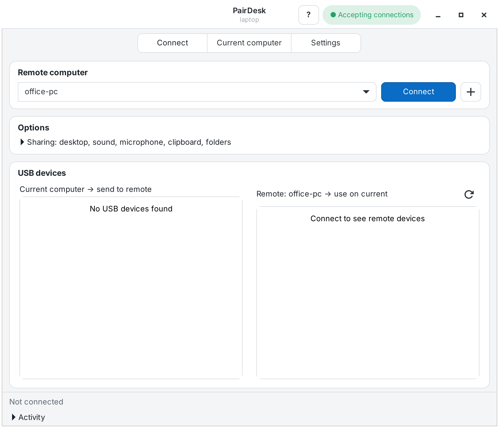
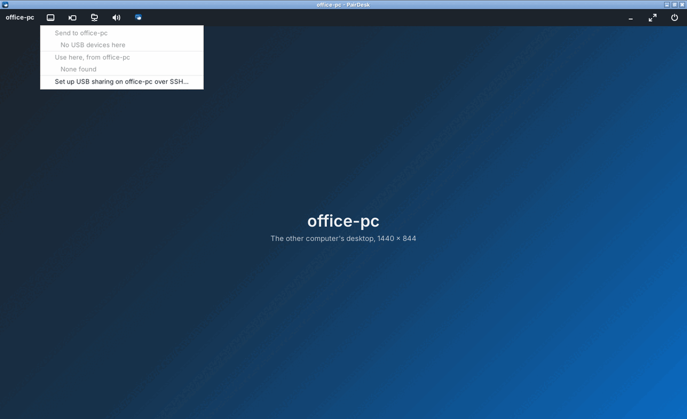

# PairDesk

Use another Linux computer as if you were sitting at it: its full desktop with sound,
microphone and clipboard, plus your own USB devices (security keys such as YubiKey,
webcams, drives) and folders, in both directions. One package for every computer;
one switch turns remote access on or off.

*A KnowReva project.* Website: https://pairdesk.knowreva.com · Licence: MIT ·
Formerly called DeskBridge (upgrading keeps your settings and pairings).

## Features

- **Full remote desktop** with sound, microphone, clipboard and printers, in PairDesk's own
  window with a **toolbar** (like Remmina): USB devices, camera, folders, minimize, full screen and
  Disconnect; in full screen it drops down from the top edge.
- **Cameras as video:** send a camera to the other computer, where Teams, Zoom, browsers and camera apps
  see it as a normal camera ("PairDesk camera"). Smooth also over Wi-Fi.
- **USB devices both ways:** use a YubiKey, webcam or USB drive plugged into the computer
  you sit at on the remote computer, or the other way round.
- **Shared folders both ways:** each computer's shared folder appears on the other.
- **Pairing like a one-time password:** a new random key for every pairing attempt and a one-time
  code shown on the other screen (hidden until you press Show), valid only for the computer that asked.
  No passwords are sent, nothing is shared between installs, and nobody in between can take part.
  See [SECURITY.md](SECURITY.md).
- **Add a remote computer wizard:** finds computers on your network by itself; a plain IP
  address is enough; the user name and port are filled in by the remote computer.
- **Set up over SSH:** if the other computer accepts SSH logins, PairDesk installs or
  updates itself there, turns remote access on and runs the guided setup, and can fetch
  the pairing code over SSH, so its screen isn't needed. The SSH password is asked once
  per session in PairDesk's own window and never saved.
- **Remembers computers by IP address:** a typed name is turned into its IP; if the router gives the
  computer a new address, PairDesk finds it again and checks it's the same computer.
- **Its own encrypted link** on its own port (default 4722), open only while remote access
  is on, running as you, never as root. A paired key can only run PairDesk's own commands.
- **Computers without a monitor:** guided setup over SSH (`pairdesk headless-setup`).
- **Reconnects by itself** after a Wi-Fi drop and puts USB devices and folders back;
  Wake-on-LAN for a sleeping computer; keeps the remote computer awake while connected.
- **Someone signed in on the remote screen?** PairDesk offers to sign that session out
  after a 30-second notice there (anyone there can cancel).
- **Paired computers update each other:** whichever computer has the older PairDesk is offered the
  newer one after connecting, and installs it only with an administrator's password there.
- **GNOME on Wayland** (Ubuntu 25.10 and later): GNOME Remote Login instead of xrdp, which can't start
  a Wayland-only GNOME (`pairdesk desktop gnome`).
- **Check this computer:** Help > Check this computer (or `pairdesk doctor`) finds what's
  missing and says how to fix each thing.
- **Minimal install:** only Python, GTK and the SSH client are required. Add-ons are
  installed when first needed, after explaining what they're for, and removed cleanly.
- **Welcome screen, help topics, light/dark themes and accent colours.**

## Works on

- Ubuntu 24.04 LTS, 26.04 LTS, 26.10 and 27.04 (in development)
- Debian 13 "trixie" (stable) and 14 "forky" (testing); Debian 12 should work too
- Any desktop (GNOME, KDE, Xfce, …), X11 or Wayland; Python 3.9 or newer

Tested by installing it and every add-on on Ubuntu 24.04, 26.04 and 27.04, with Python
3.11 to 3.14.

## Install (on both computers)

From the KnowReva apt repository (updates arrive with normal system updates):

    sudo wget -qO /usr/share/keyrings/knowreva.gpg https://pairdesk.knowreva.com/apt/knowreva.gpg
    printf 'Types: deb\nURIs: https://pairdesk.knowreva.com/apt\nSuites: stable\nComponents: main\nSigned-By: /usr/share/keyrings/knowreva.gpg\n' | sudo tee /etc/apt/sources.list.d/knowreva.sources
    sudo apt update && sudo apt install pairdesk

Or a downloaded file: `sudo apt install ./pairdesk_2.9.2-1_all.deb`

## First start

A welcome screen asks what the computer is for:

- **Reach another computer from here:** opens the Add a remote computer wizard.
- **Reach this computer from another one:** turns on remote access.
- **Both.**

## Add a remote computer (the + button)

1. PairDesk lists the computers on your network that accept connections. Pick one, or
   type its address: just the IP (e.g. `192.168.1.20`) or a name (`office-pc.local`).
2. If that computer accepts SSH logins, PairDesk offers **Pair over SSH**: sign in with its
   password (asked once, not saved) and PairDesk pairs by itself. No code, nothing to do at its
   screen. Otherwise PairDesk asks it to show a pairing code (hidden until Show is pressed there):
   type it.
3. **Connect now.**

In a terminal: `pairdesk pair 192.168.1.20 --ssh` (no code), or `pairdesk pair 192.168.1.20` (code).

If nothing answers, the wizard says why and what to check. If PairDesk isn't installed or
switched on there but SSH answers, **Set it up over SSH** does it from here: it installs
PairDesk if it's missing or older (never downgrades), turns remote access on, and asks
before each other step.

## During a session

The desktop opens in PairDesk's window. Its toolbar: **USB devices** (send yours, use theirs, also ones
plugged in later), **Camera** (send a camera as video), **Folders**, **Sound** (where the remote sound plays, which
microphone is sent, echo reduction), the PairDesk window, minimize, full
screen and **Disconnect**. In full screen, move the mouse to the top edge to show the toolbar.
Settings > Desktop window switches back to the viewer's own window.

A camera sent with **Camera** shows up on the other computer as "PairDesk camera" for any app. It needs
ffmpeg on the computer with the camera and the virtual camera (v4l2loopback) on the other one; PairDesk
offers both, the remote one over SSH.

## Remote access (the computer you want to reach)

Current computer > **Let paired computers connect.** Off (default): no PairDesk port is
open. On: PairDesk's link listens on its port (default 4722, Settings > Connection); it
runs as you, keeps working when the window is closed or after you sign out, and only
accepts paired computers. Missing pieces show as buttons under Status.

The desktop needs a desktop server: Current computer > Desktop sharing > **Set up…**
offers GNOME Remote Login (Ubuntu/GNOME) or xrdp (any desktop; no monitor needed). GNOME 49 and later
(Ubuntu 25.10 and later) runs only on Wayland, which xrdp can't start: use GNOME Remote Login there
(over SSH: `pairdesk desktop gnome`).

## USB sharing (optional, once per computer)

Settings > **Set up USB sharing** (admin password, once). Then on the Connect tab flip the
switch next to a device: *Current computer → send to remote* or *Remote → use on current*.
A shared device leaves the computer it's plugged into until you switch it off or
disconnect. Settings > **Undo setup** gives every device back and removes the setup.

## Computer without a monitor

From the computer you sit at: Help (?) > **Set up a computer without a monitor…**, or the
wizard's **Set it up over SSH**. By hand, over SSH on that computer:

    pairdesk headless-setup

It checks each step and asks before changing anything: remote access on, keep running with
nobody signed in, xrdp desktop server, automatic sign-in off, no sleeping at the sign-in
screen (a system setting in `/etc/dconf/db/gdm.d/90-pairdesk-nosleep`, removed on
uninstall), firewall, then pairing.

## Updating

With the apt repository, PairDesk updates with your normal system updates. Between paired computers:
when you connect and one has a newer PairDesk, PairDesk asks before signing in: **Update first** or
**Skip and connect**. An older computer here gets the newer version copied from the remote one; an older
remote computer is sent this one, and asks on its screen, or (with nobody there) a terminal installs it
over SSH. Nothing is installed without an administrator's password on the computer being updated. Later,
over SSH on that computer: `pairdesk update --install`. Terminal: `pairdesk update NAME`.
Both computers need 2.7.0 or later.

## Unpairing

Current computer > Paired computers shows each paired computer and the direction.
**Unpair** removes the pairing on both computers; if the other one can't be reached, it
removes it by itself the next time PairDesk starts there or tries to connect.

## What goes where

- Desktop, clipboard, sound, microphone, printers: RDP (xrdp or GNOME Remote Login)
- USB devices: USB/IP, both directions
- Folders: SFTP; the other computer's folder appears in `~/PairDesk/<name>`

All of it runs inside one encrypted connection on PairDesk's port. The USB/IP and RDP
ports are closed to the network by a firewall rule (after USB setup). "Direct desktop
stream" (optional, FreeRDP 3) sends the picture straight to the desktop server, accepting
only the certificate checked over the link.

## Terminal use

    pairdesk                              open the app
    pairdesk access on|off                let paired computers connect
    pairdesk scan                         computers on the network that accept connections
    pairdesk pair 192.168.1.20 [CODE]      pair (asks the other computer for a code)
    pairdesk pair 192.168.1.20 --ssh       pair by signing in over SSH (no code)
    pairdesk pairing                      on a computer without a screen: show the code
    pairdesk headless-setup               guided setup of a computer without a monitor
    pairdesk doctor                       check this computer
    pairdesk list | unpair NAME           paired computers
    pairdesk update NAME                  update whichever computer has the older PairDesk
    pairdesk update --install             install the update a paired computer sent here
    pairdesk desktop gnome|xrdp           choose the desktop server
    pairdesk connect NAME [--no-desktop]  connect from the terminal
    pairdesk usb | send NAME KEY | take NAME KEY
    pairdesk setup | unsetup              optional USB sharing setup
    pairdesk features | install NAME      optional add-ons

See `man pairdesk`.

## Uninstall

Settings > **Uninstall PairDesk…** or `sudo pairdesk-uninstall` (`--dry-run` shows what it
would do). It gives shared USB devices back, undoes setup, and removes PairDesk and only the
add-ons it installed; packages you installed yourself and your shared folder's files stay.

## Building from source

    sudo apt install devscripts debhelper lintian
    git archive --prefix=pairdesk-2.9.2/ v2.9.2 ':!debian' | gzip -n > ../pairdesk_2.9.2.orig.tar.gz
    dpkg-buildpackage -us -uc && lintian -I ../pairdesk_*.changes

`make check` runs the tests. `tools/publish-apt.sh REPO_DIR file.deb` publishes a signed apt
repository with app-store data (publisher, licence, icon) for App Center and GNOME Software.

## Security

How pairing and the link keep a computer safe, and how to report a problem: [SECURITY.md](SECURITY.md).

## Licence

MIT, © 2026 KnowReva. See `LICENSE`.
